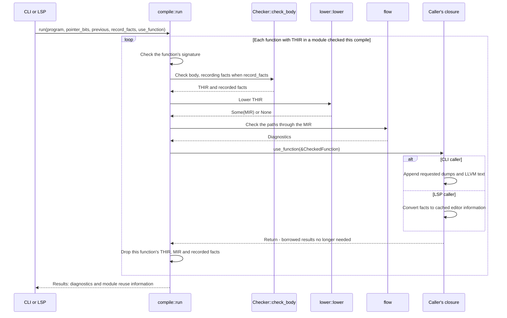

# Peeper

Peeper is an experimental systems programming language and native compiler. This
repository contains the compiler, bundled library, package tooling, language
server, and executable source fixtures.

> Peeper is pre-release software. Language, package, and compiler interfaces may
> change without compatibility guarantees.

## Current capabilities

The compiler is being rebuilt in Rust; this list covers what the rebuild does
today.

- Parsing with error recovery, and fixes that `peeper fix` or an editor applies.
- Type checking of integers, floats, `bool`, C strings, functions, constants and
  modules, with constant folding.
- Path checks: a variable used before it is set, a missing `return`, and
  unreachable code.
- THIR and MIR lowering to LLVM IR and native executables through Clang.
- Project manifests, `peeper init`, incremental checking, and an LSP server.

See the [open roadmap](https://github.com/PeeperLanguage/compiler/issues) for
unfinished language and runtime work.

## Learning the compiler

The design documents record the compiler's decisions and their reasons. Verify
details against the source when extending it.

- [`docs/architecture.md`](docs/architecture.md): loading files, parsing in
  parallel, imports, the module graph, and diagnostics.
- [`docs/overall-design.md`](docs/overall-design.md): incremental compiles for
  the command line and the LSP.
- [`docs/ir-design.md`](docs/ir-design.md): checking, THIR, MIR and LLVM.
- [`docs/roadmap.md`](docs/roadmap.md): milestones, done and next.

### How the per-function callback works

The CLI and language server call
[`compile::run`](crates/driver/compile/src/lib.rs) with a closure named
`use_function`. It checks and lowers one function, calls that closure with
borrowed results, then drops the function's THIR and MIR. The callback runs
synchronously inside `compile`; it is not a separate thread or a task queued for
later.



The callback can update state captured from its caller. The
[`CLI closure`](crates/driver/peeper/src/driver.rs) keeps generated text; the
[`LSP closure`](crates/driver/lsp/src/checked.rs) keeps name locations and
display text. Neither needs to retain every function's IR. Types remain owned
by the compile for its whole duration; a callback must copy any information it
needs afterward into its own storage.

This is a per-function handoff, not a whole-program success notification.
Broken bodies can still provide THIR and names for editor recovery, with no
MIR. The CLI publishes dumps or links only after checking all diagnostics.
Modules reused from the previous compile produce no callbacks; the LSP keeps
their previously cached names.

## Binary installation

> Not available yet for the rewritten compiler (`docs/roadmap.md`). Use
> [Build from source](#build-from-source).

Linux and macOS:

```
curl --proto '=https' --tlsv1.2 -fsSL https://github.com/PeeperLanguage/compiler/releases/latest/download/install.sh | sh
```

Windows PowerShell:

```
irm https://github.com/PeeperLanguage/compiler/releases/latest/download/install.ps1 | iex
```

Bootstrap scripts detect `amd64` or `arm64` automatically, download the
release manifest and the compiler and toolchain packs for the detected host,
verify every SHA-256 digest, and activate the installation atomically. macOS
running under Rosetta installs the native `arm64` build. macOS requires
Command Line Tools and working `xcrun --sdk macosx --show-sdk-path`.

Bootstrap scripts persist the Peeper binary directory in the user PATH
idempotently; restart your terminal afterward, because a piped shell cannot
modify its parent environment.

## Source build requirements

- A Rust toolchain (`cargo`, with `rustfmt` and `clippy`) for the edition in
  [`Cargo.toml`](Cargo.toml).
- `curl`, `tar` and `jq` (on Windows, PowerShell), with which
  `scripts/setup.sh` (`scripts/setup.ps1`) puts the LLVM toolchain in
  `build/toolchains/native`: the pack CI builds, else an installed LLVM 23 or
  newer. Peeper runs only that clang, never one on the PATH.
- On macOS, Xcode's command line tools (`xcode-select --install`): their SDK
  holds the C library and headers programs are built with.
- On Windows, Git Bash, which runs `scripts/build.sh`.
- Git for cloning the compiler and fetching packages.

## Build from source

```bash
git clone https://github.com/PeeperLanguage/compiler.git
cd compiler
bash scripts/setup.sh
bash scripts/build.sh
build/bin/peeper
```

`scripts/setup.sh` puts the toolchain in `build/toolchains/native`, once;
`scripts/build.sh` builds:

- compiler binary: `build/bin/peeper`
- bundled libraries: `build/libs`
- runtime library: `build/runtime`

Run with no arguments, `peeper` prints its usage.

## Create a project

`peeper init` makes the current folder a project: a `peeper.toml` that names
it and a `src/main.peep` that holds `main`. It asks for the name, with the
folder's name as the default, unless one is given:

```bash
mkdir hello_peeper
cd hello_peeper
/path/to/compiler/build/bin/peeper init hello_peeper
/path/to/compiler/build/bin/peeper run
```

The generated `src/main.peep`:

```peeper
fn main() {
    Write(Stdout, c"Hello from Peeper!\n", 19);
}
```

A name is lowercased, and spaces and `-` become `_`. A name that is not a
package name (a letter, then letters, digits and `_`), a bundled library's name
or an existing `peeper.toml` stops it; an existing `src/main.peep` is kept.

## Commands

| Command | Purpose |
| --- | --- |
| `peeper check [path]` | Report the program's errors. |
| `peeper fix [path]` | Apply the fixes the errors suggest, then report what is left. |
| `peeper build [-o program] [path]` | Check the program and link it into an executable, named after the project or file unless `-o` names it. |
| `peeper run [path] [args]` | Build the program to a temporary file and run it with the arguments. |
| `peeper -dump [thir \| mir \| ll] [path]` | Check, then write each module's THIR, MIR and LLVM IR, or only the one named, to `build/debug/dumps`. |
| `peeper init [name]` | Make the current folder a project: write `peeper.toml` and `src/main.peep`, asking for the name unless given. |
| `peeper lsp` | Serve editors as a language server over standard input and output. |

`path` is a project folder or a single `.peep` file, and defaults to the
current folder. `check`, `fix`, `build` and `run` take `-target <name>` to
check and build for another machine, such as `-target i686-linux` for 32-bit
x86 Linux, which a 64-bit x86 Linux runs once its 32-bit C library is
installed (Fedora: `glibc-devel.i686`).

## Development

```bash
cargo fmt --check
cargo clippy --all-targets -- -D warnings
cargo test
bash scripts/build.sh
```

Read [`CONTRIBUTING.md`](CONTRIBUTING.md) before proposing a change. Mandatory engineering requirements live in [`RULES.md`](RULES.md); Rust and compiler design guidance live in [`rust-style.md`](rust-style.md) and [`COMPILER_GUIDELINES.md`](COMPILER_GUIDELINES.md).

Security reports belong through the private process in
[`SECURITY.md`](SECURITY.md), not a public issue. Community participation follows
[`CODE_OF_CONDUCT.md`](CODE_OF_CONDUCT.md).

## License

Peeper is licensed under the [GNU General Public License v3.0](LICENSE).
