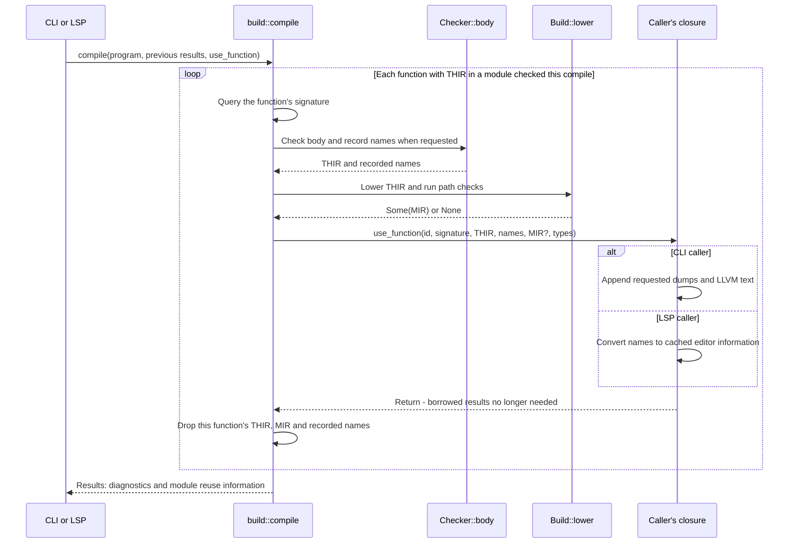

# Peeper

Peeper is an experimental systems programming language and native compiler. This
repository contains the compiler, bundled library, package tooling, language
server, and executable source fixtures.

> Peeper is pre-release software. Language, package, and compiler interfaces may
> change without compatibility guarantees.

## Current capabilities

- Static semantic analysis with explicit compiler phases.
- Ownership, move, borrow, pointer, and reference checks.
- Scalars, aggregates, arrays, slices, optionals, interfaces, and modules.
- THIR and MIR lowering to LLVM IR and native executables through Clang.
- Project manifests, dependency commands, source checking, and an LSP server.

See the [open roadmap](https://github.com/PeeperLanguage/compiler/issues) for
unfinished language and runtime work.

## Learning the compiler

[`Code-tour.md`](Code-tour.md) walks one `.peep` file through every phase to a native
binary, with diagrams and the real entry points at each stop.

[`docs/compiler-architecture.md`](docs/compiler-architecture.md) records current compiler mechanisms and their rationale. Verify mutable details against source when extending syntax, semantic types, graphs, or analyses.

### How the per-function callback works

The CLI and language server call [`build::compile`](crates/build/src/lib.rs)
with a closure named `use_function`. The scheduler checks and lowers one
function, calls that closure with borrowed results, then drops the function's
THIR and MIR. The callback runs synchronously inside `compile`; it is not a
separate thread or a task queued for later.



The callback can update state captured from its caller. The
[`CLI closure`](crates/peeper/src/driver.rs) keeps generated text; the
[`LSP closure`](crates/lsp/src/lib.rs) keeps name locations and display text.
Neither needs to retain every function's IR. Types remain owned by the
scheduler for the duration of the compile; a callback must copy any information
it needs afterward into its own storage.

This is a per-function handoff, not a whole-program success notification.
Broken bodies can still provide THIR and names for editor recovery, with no
MIR. The CLI publishes dumps or links only after checking all diagnostics.
Modules reused from the previous compile produce no callbacks; the LSP keeps
their previously cached names.

## Binary installation

Linux and macOS:

```
curl --proto '=https' --tlsv1.2 -fsSL https://github.com/PeeperLanguage/compiler/releases/latest/download/install.sh | sh
```

Windows PowerShell:

```
irm https://github.com/PeeperLanguage/compiler/releases/latest/download/install.ps1 | iex
```

Bootstrap scripts detect `amd64` or `arm64` automatically, download the
release manifest and the compiler and toolchain packs for the detected host,
verify every SHA-256 digest, and activate the installation atomically. macOS
running under Rosetta installs the native `arm64` build. macOS requires
Command Line Tools and working `xcrun --sdk macosx --show-sdk-path`.

Bootstrap scripts persist the Peeper binary directory in the user PATH
idempotently; restart your terminal afterward, because a piped shell cannot
modify its parent environment. Run `peeper doctor` after installation.

See [`docs/distribution.md`](docs/distribution.md) for support policy, release
security, and maintainer setup.

## Source build requirements

- A Rust toolchain (`cargo`, with `rustfmt` and `clippy`) for the edition in
  [`Cargo.toml`](Cargo.toml).
- LLVM Clang available as `clang` for native `build` and `run` commands.
- Git for cloning the compiler and fetching packages.

## Build from source

```bash
git clone https://github.com/PeeperLanguage/compiler.git
cd compiler
bash scripts/build.sh
build/bin/peeper -help
```

`scripts/build.sh` builds:

- compiler binary: `build/bin/peeper`
- bundled libraries: `build/libs`

## Create a project

`peeper init` initializes the current directory:

```bash
mkdir hello-peeper
cd hello-peeper
/path/to/compiler/build/bin/peeper init hello-peeper
/path/to/compiler/build/bin/peeper run
```

Generated source starts with:

```peeper
fn main() {
    println("Hello from Peeper!");
}
```

## Commands

| Command | Purpose |
| --- | --- |
| `peeper build [path]` | Compile a program to a native executable. |
| `peeper run [path] [args]` | Compile and run a program on the host target. |
| `peeper check [path ...]` | Check `.peep` files or directories without linking. |
| `peeper init [name]` | Initialize `peeper.toml` and `src/main.peep`. |
| `peeper get [pkg ...]` | Install manifest or named dependencies. |
| `peeper update [pkg ...]` | Update locked dependencies. |
| `peeper sniff [pkg ...]` | Preview available dependency updates. |
| `peeper list` | List direct and transitive dependencies. |
| `peeper remove <alias>` | Remove one dependency. |
| `peeper cleanup` | Remove orphaned cached dependencies. |
| `peeper doctor` | Validate installation, managed toolchain, and runtime. |
| `peeper lsp` | Start the language server over standard input/output. |

Run `peeper -help` for the complete command list and current aliases.

## Development

```bash
cargo fmt --check
cargo clippy --all-targets -- -D warnings
cargo test
bash scripts/build.sh
```

Read [`CONTRIBUTING.md`](CONTRIBUTING.md) before proposing a change. Mandatory engineering requirements live in [`RULES.md`](RULES.md); Go and compiler design guidance live in [`go-style.md`](go-style.md) and [`COMPILER_GUIDELINES.md`](COMPILER_GUIDELINES.md).

Security reports belong through the private process in
[`SECURITY.md`](SECURITY.md), not a public issue. Community participation follows
[`CODE_OF_CONDUCT.md`](CODE_OF_CONDUCT.md).

## License

Peeper is licensed under the [GNU General Public License v3.0](LICENSE).
