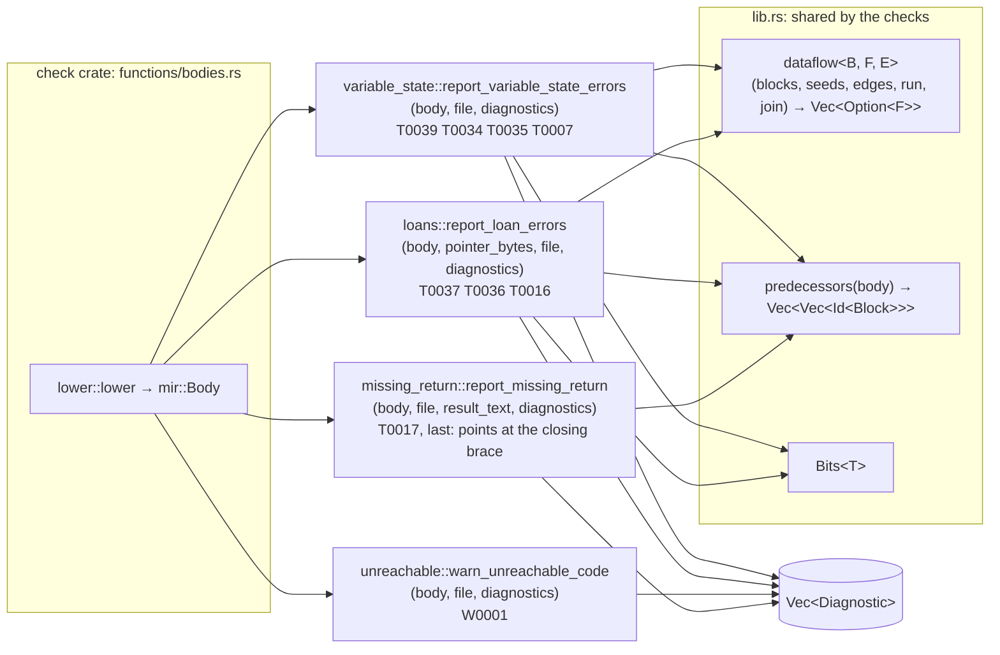
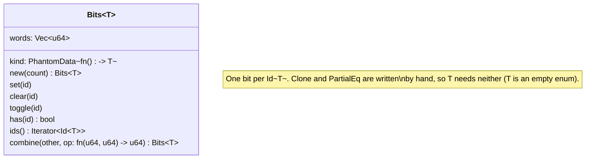
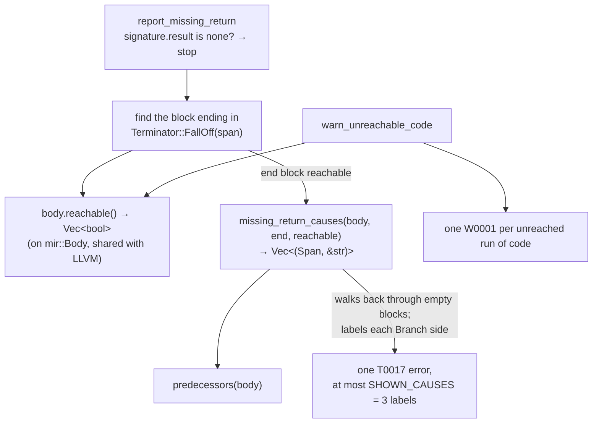
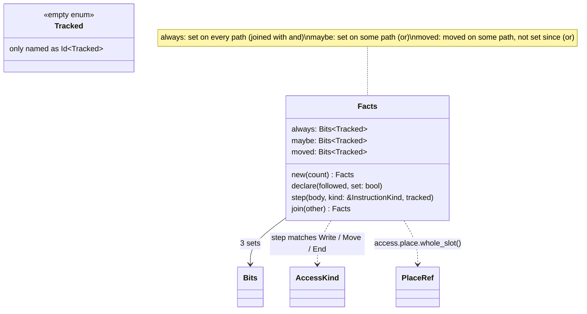
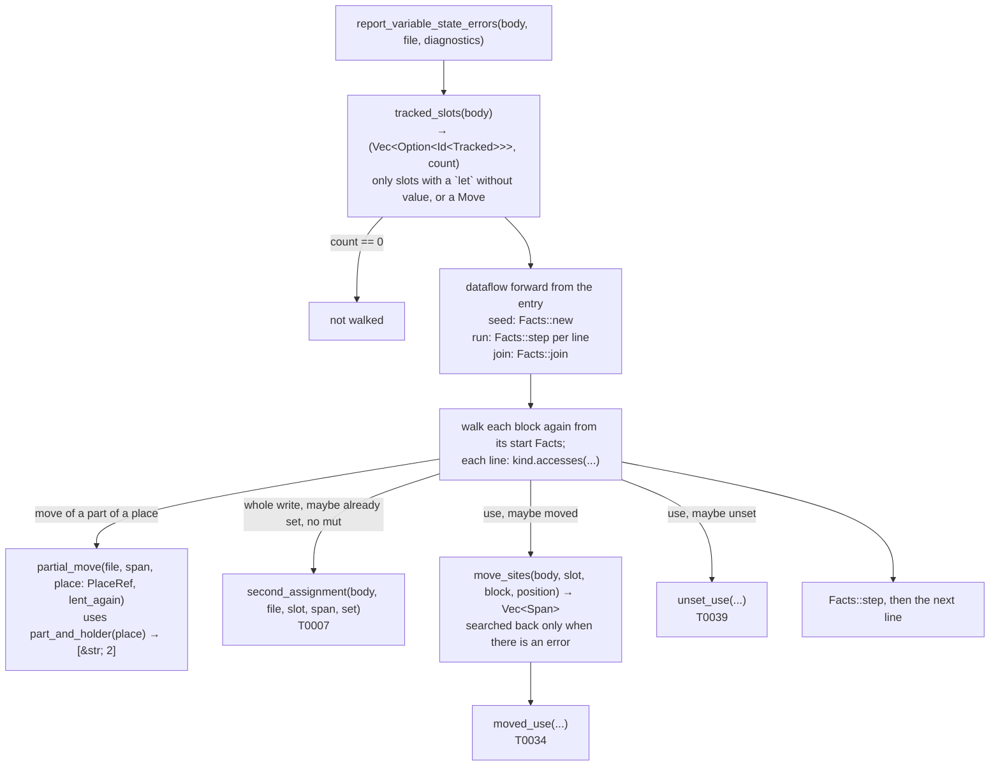
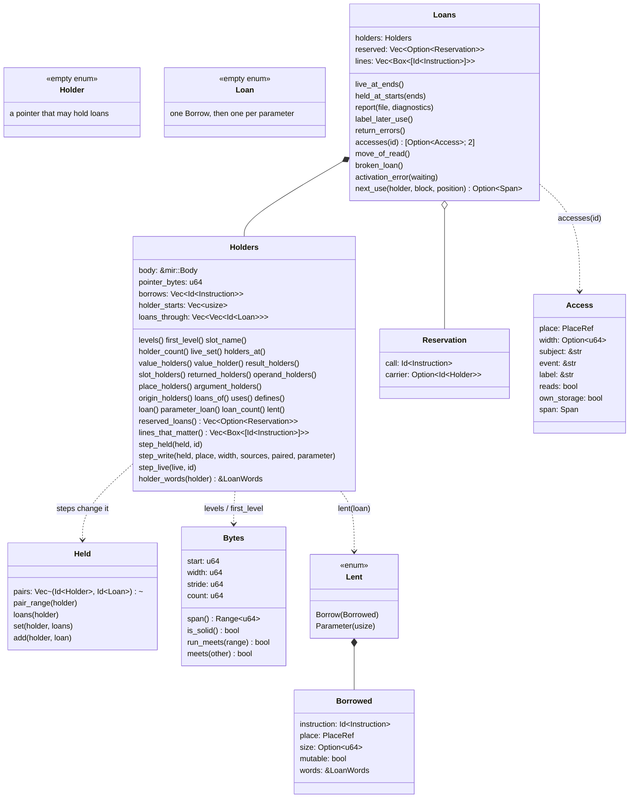
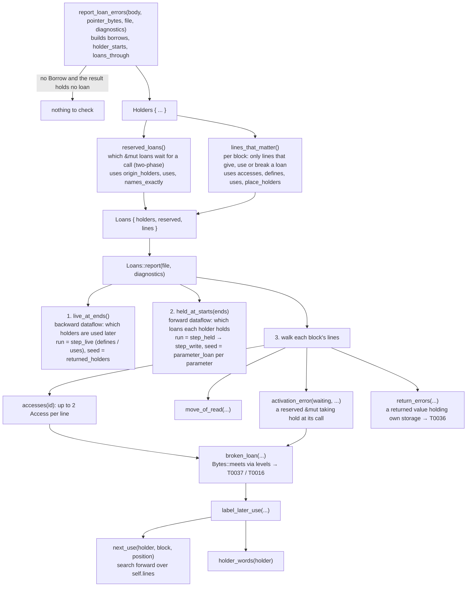

# The `flow` crate

> The crates have moved since this was written: the phases are now
> `crates/syntax/*` (the tree crate is `tree`), `crates/check`,
> `crates/model`, `crates/lower`, `crates/flow` and `crates/eval`.

The path checks: errors that depend on which routes execution can take
through one function. Source: `crates/flow/src/`: `lib.rs` (the
shared engine), `missing_return.rs`, `unreachable.rs`, `variable_state.rs`,
and `loans/` (`mod.rs`, `places.rs`, `holders.rs`, `two_phase.rs`,
`passes.rs`, `errors.rs`). Each check only reads one function's
`mir::Body` and pushes `Diagnostic`s.

## 1. Who calls it, what it gives

The checker runs the four checks on each function's MIR
(`crates/check/src/functions/bodies.rs:84-90`).

## 2. `lib.rs`, `missing_return.rs`, `unreachable.rs`: the engine and the two small checks

`dataflow` is the engine behind both big checks. It takes:

- `seeds`: the first blocks and their facts;
- `edges`: the blocks that come next;
- `run`: how one block changes the facts;
- `join`: how facts merge where paths meet.

It repeats until nothing changes, so loops work too. Forward, the edges are
`Terminator::targets`; backward, they are `predecessors`.

## 3. `variable_state.rs`: unset, moved, assigned twice

## 4. `loans/`: the types

A loan is one `Borrow` (then one parameter loan per parameter). A holder is a
pointer that may hold loans: each slot's holders, then one per instruction
giving a pointer, then one for a result kept in memory.

Which file holds what. `Holders` and `Loans` are defined in `mod.rs`; each
file adds the methods of its job in its own `impl` block.

| File | Holds |
| --- | --- |
| `mod.rs` | `Holder`, `Loan`, `Holders`, `Loans`, `report_loan_errors`, `holder_ids`, the walk `Loans::report` |
| `places.rs` | `Bytes`, `Holders::levels`, `Holders::first_level`, `known_until_through`, `names_exactly`, the `Bytes` test |
| `holders.rs` | numbering (`holder_count` ... `lent`), `uses`, `defines`, `Held`, `Lent`, `Borrowed` |
| `two_phase.rs` | `Reservation`, `Holders::reserved_loans` |
| `passes.rs` | `sorted_union`, `lines_that_matter`, `step_held`, `step_write`, `step_live`, `Loans::live_at_ends`, `Loans::held_at_starts` |
| `errors.rs` | `Access`, `accesses`, `broken_loan`, `move_of_read`, `activation_error`, `return_errors`, `label_later_use`, `next_use`, `holder_words`, `slot_name` |

Helper functions outside the impls: `holder_ids(range)` (`mod.rs`, used by
the numbering and the passes), `sorted_union(a, b)` (`passes.rs`, only the
passes use it), `known_until_through(steps)` and `names_exactly(place)`
(`places.rs`).

## 5. `loans/`: how one check runs

