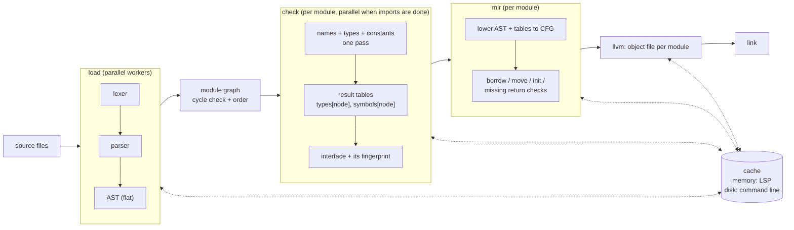
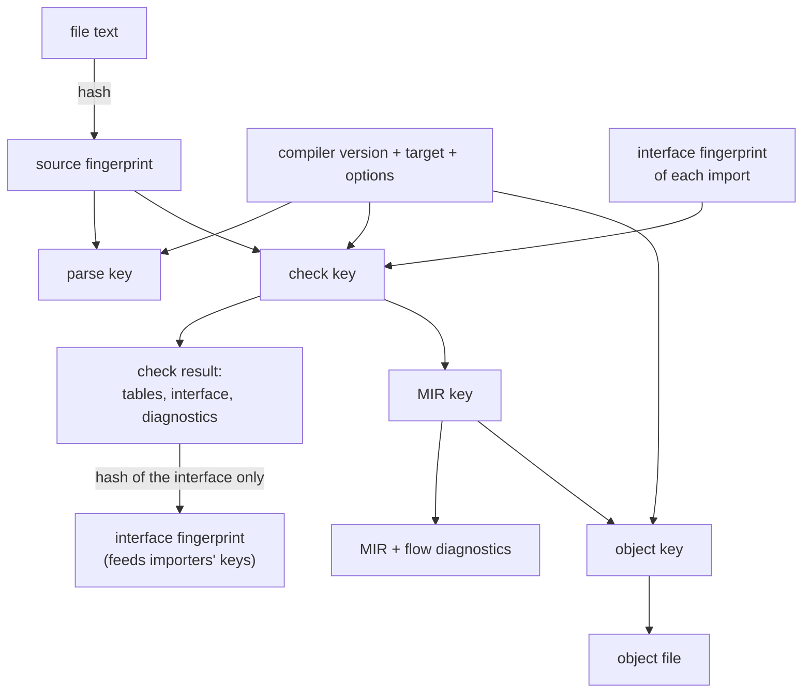
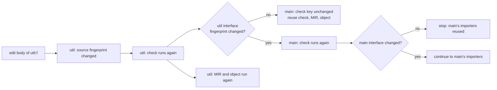
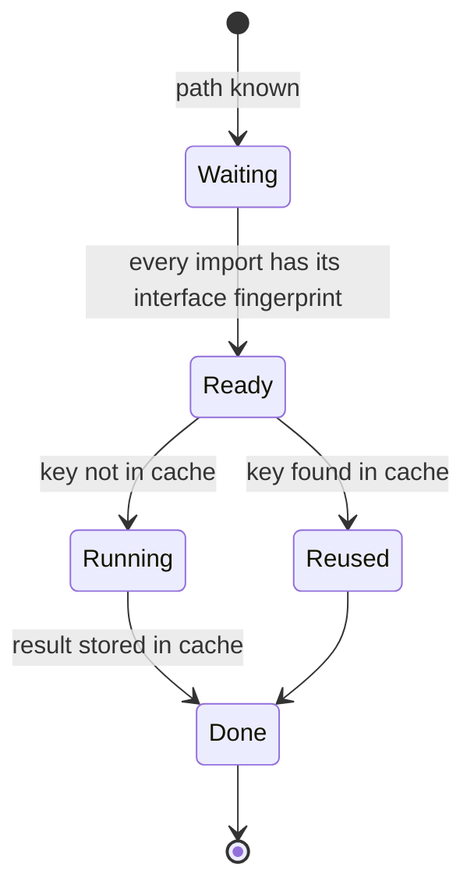
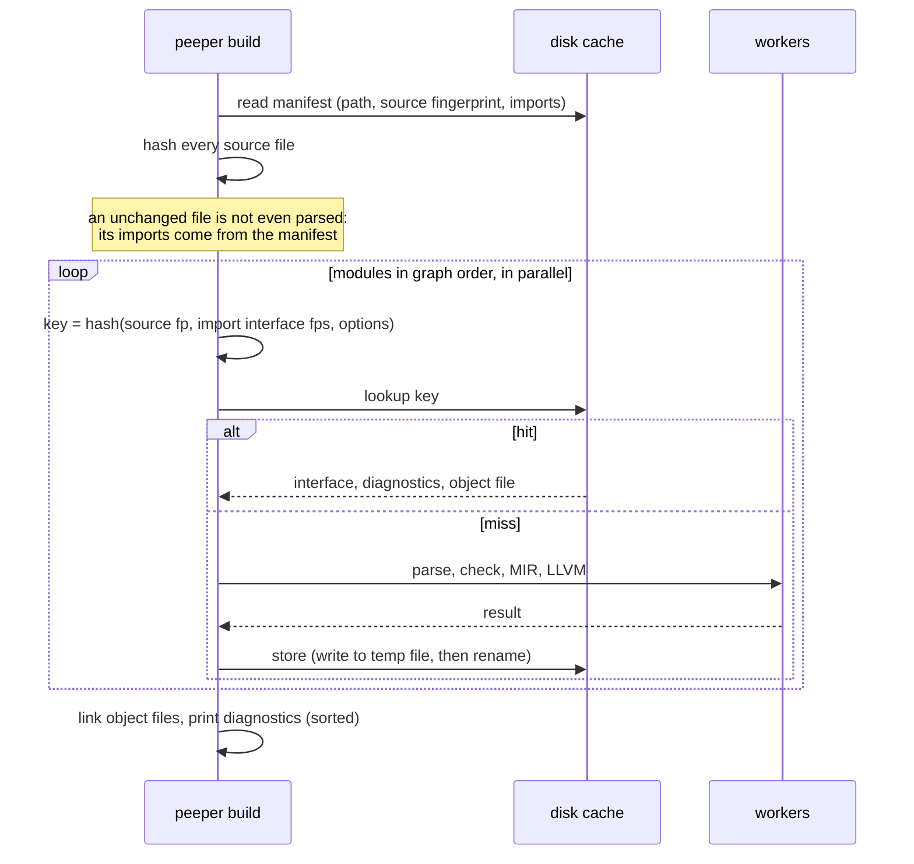
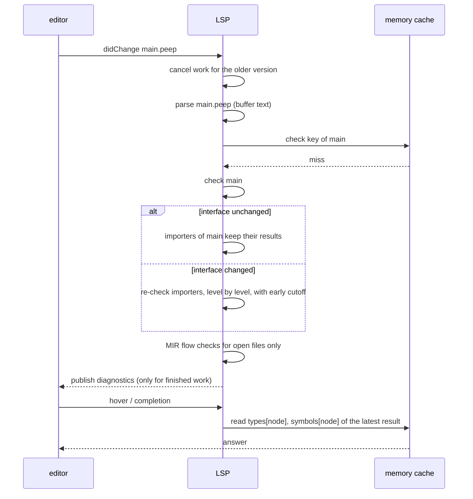
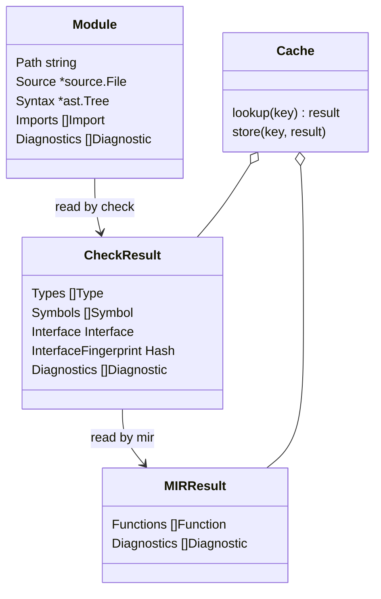
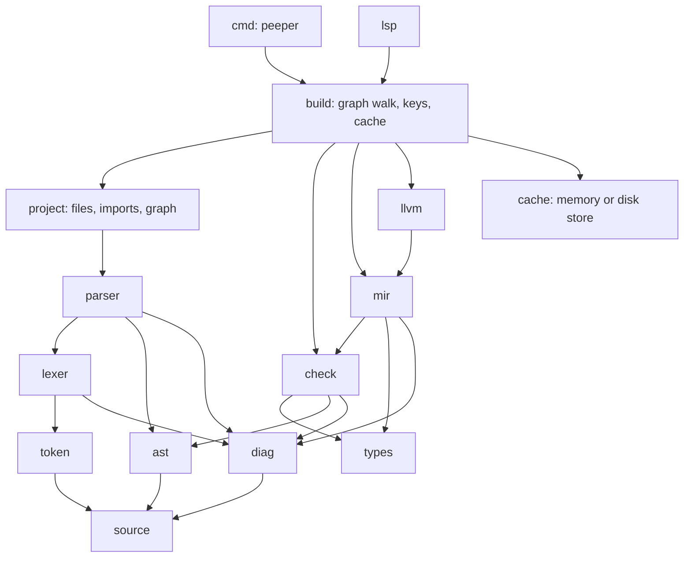

# Overall design: incremental compiler and LSP

Status: PROPOSAL, not yet approved.

This puts the decisions so far (see `architecture.md`) together with one more
goal: **after a small edit, only the work that the edit really affects runs
again**, both in the LSP, which keeps everything in memory, and in the command
line compiler, which starts fresh on every run.

## The idea in one paragraph

Every step is a **pure function**: its output depends only on its inputs. Each
input is named by a **fingerprint** (a hash of its content). A step's **key** is
the hash of all its input fingerprints. Before running a step, look its key up in
a **cache**; on a hit, reuse the stored result instead of running the step. The
LSP keeps the cache in memory; the command line keeps it on disk. It is the same
code with a different store. Reuse stops spreading as early as possible: a module
whose **interface** (what importers can see) did not change does not make its
importers run again, even if its function bodies changed.

## 1. Pipeline

> Superseded by [`ir-design.md`](ir-design.md) (proposal, 2026-10-17): check builds a THIR per body; there is a `thir` crate and no check tables over the AST.

Every step returns `(result, diagnostics)`. Diagnostics are cached with the result
and shown again when the result is reused, so warnings never disappear on a
cached run.

## 2. Fingerprints and keys

What goes into a module's **interface** (and so into its fingerprint):

- names and signatures of exported functions, types, constants and variables;
- constant values;
- the syntax of exported generic declarations and of default argument values,
  because importers build instances and expand defaults from them;
- type layouts that importers lower against.

Function bodies are **not** in the interface. Editing a body changes the
module's own keys only.

The interface is computed by `check` from its results. (The old compiler built
its export fingerprint in the parser, which made the parser own a semantic
decision.)

## 3. Early cutoff

`main` imports `util`. The user edits the body of a function in `util`.

The same check happens at every level, so a change spreads only as far as
interfaces actually change.

## 4. Scheduling one module

A small loop walks the graph in order; all `Ready` modules run in parallel on a
pool of workers. There is no phase enum and no per-module mutable phase field:
a module is `Done` when its result exists.

## 5. Command line run (stateless, disk cache)

What the disk cache stores per module: the manifest entry, the serialized
interface (importers that must re-check read it instead of re-checking this
module), the diagnostics, and the object file. It does **not** store ASTs, tables
or MIR: a module that must run again re-parses its file, which is cheaper than
reading a stored tree.

Rules for the disk cache:

- the compiler version, target and options are part of every key, so an old
  cache is simply never hit;
- entries are content addressed and never changed; each is written to a temporary
  file and renamed into place, so a crash or two builds at once cannot leave a
  half-written entry;
- a corrupt or unreadable entry is a miss, never an error;
- the cache can be deleted at any time.

## 6. LSP edit (in memory)

- All other modules' results are reused **by pointer**: they are immutable, so
  sharing them between versions is safe.
- Results are published only when complete; a newer edit cancels unfinished work.
- The memory cache keeps the latest result per module and drops older ones.

## 7. Data and ownership

> Superseded by [`ir-design.md`](ir-design.md) (proposal, 2026-10-17): check results live in THIR bodies and signatures in `ir`, not in tables over the AST.

- Every value is written once, by one step, and is immutable after that.
- The cache is the only shared structure. It only adds entries and never changes
  one, so concurrent use cannot corrupt results.
- A step for module M reads M's own data and the finished results of M's imports,
  nothing else.

## 8. Packages

> Superseded by [`ir-design.md`](ir-design.md) (proposal, 2026-10-17): crates are `ir`, `thir`, `mir`, `llvm`, `build` as listed there.

| package | owns |
| --- | --- |
| `source`, `token`, `lexer`, `ast`, `parser`, `diag` | done or in progress |
| `project` | reading files, resolving imports, the module graph |
| `check` | names, types, constants, interface, interface fingerprint |
| `types` | the type model |
| `mir` | lowering, all control-flow checks |
| `llvm` | object files |
| `cache` | one interface, two stores (memory, disk) |
| `build` | the graph walk: keys, cache lookups, parallel workers; used by `cmd` and `lsp` alike |
| `lsp` | editor protocol; calls `build` with buffer text and a memory cache |

Compared with the old compiler: no `pipeline`, `phase`, `project`, `module`
registry, `prelude`, `collector`, `binder`, `resolver`, `typeresolution`,
`symbols`, `place`, `usage`, `intrinsics`, `analysis`, `thir`, `cfg`,
`exprlower`, `typelower` or `constvalue` package.

## Cost on the hot path

- Hashing all source files on each command line run: fast (about 1 GB/s with a
  standard hash), and it replaces parsing for unchanged files.
- One cache lookup per module per step.
- Computing the interface fingerprint: one walk over a module's exports after
  checking.
- With a flat AST and result tables, results are a few arrays each, which makes
  them cheap to keep in memory and to serialize for the disk cache.

## Decisions for the user

1. Unit of reuse: one module (file) to start; per-function reuse for MIR and
   object files can come later without changing the design.
2. What the disk cache stores: manifest, interface, diagnostics, object file
   (proposed), but not ASTs, tables or MIR.
3. Where the disk cache lives: in the project (`.peeper/cache/`) or in the user's
   cache directory.
4. The hash function: a fast non-cryptographic 128-bit hash, or SHA-256 (slower,
   but no collision worry).
5. Generic instances: built by the importing module from the declaring module's
   interface (the declaration syntax is part of it), merged by identity at MIR or
   link time.
