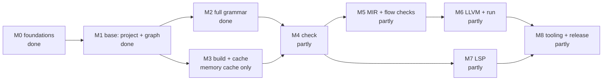

# Roadmap: the fresh compiler

Status: PROPOSAL, kept current as work lands. Design: `architecture.md`,
`overall-design.md`. Which features each milestone covers so far: `PROGRESS.md`.

Each milestone ends in something that runs and is tested. Every piece brought
back from the old compiler passes three questions (needed now? simplest form?
something else already does it?) and is optimized before the next piece starts.

## M0 Foundations (done)

- Design: `architecture.md` (base, diagnostics), `overall-design.md` (incremental).
- `source` (files, byte spans), `token`, `lexer` (hand-written, 40x faster than
  the old one, same tokens and errors on every fixture), `diagnostics` (self-contained
  diagnostics, printer, quick-fix data), `pkg/colors` (now a module of `diagnostics`).
- AST representation chosen by prototypes (four options measured): flat node
  array, Zig style, without hand-written guards.

## M1 Base: many files, imports, module graph (done)

Goal: the part every later step stands on. A project of many files loads in
parallel, imports resolve, the graph is checked, output is the same every run.

- `ast`: flat node array (two slots per node, documented per kind), grammar
  subset only:
  imports, functions, `let`, `return`, expression statements, names, numbers,
  strings, calls, binary operators.
- `parser`: that subset.
- `project::manifest`: reads `peeper.toml` in the given folder (the project name).
- `project`: package map (`package:path` imports), import resolution, coordinator
  and worker pool, implicit prelude import, cycle check, deterministic order.
- `peeper`: `peeper check [path]`.

Exit: tests for nested imports, every import error at the right line, cycles with
their path, same order every run on a many-module project loaded in parallel
(no data race: the workspace forbids `unsafe`).

## M2 Full grammar

Goal: parse the whole language into the flat tree.

- Types (pointers, references, optionals, arrays, generics), structs, enums,
  interfaces, methods, attributes, doc comments, `if`/`for`/`match`, patterns,
  literals of every kind, `orelse`, `as`, `is`, pipes.
- Expressions: Pratt with one precedence array; statements and declarations:
  recursive descent. Struct literal ambiguity in `if`/`for`/`match` headers: a
  context flag (to confirm against the old parser's cases).
- `Walk`: one function listing every kind's children.
- Error recovery: one mistake gives one error. (The M1 subset parser reports
  five errors for `fn f( {`.)

Exit: same syntax diagnostics as the old parser on every old fixture file;
node ends never decrease and `NodeAt` matches a full scan, on all of them and on
broken inputs.

## M3 Build and cache (incremental base)

Goal: the run loop both `peeper` and the LSP use, with reuse.

- `compile` (first named `build`): graph walk, per-module states (waiting, ready, reused, running, done),
  worker pool.
- Fingerprints: content hash, with file size and time only as a shortcut to skip
  re-reading unchanged files.
- `cache`: one interface, a memory store (LSP) and a disk store (command line,
  atomic writes, version in every key).

Exit: a second run of an unchanged project parses nothing; editing one file
re-parses only it.

## M4 Check

> Superseded by [`ir-design.md`](ir-design.md) (proposal, 2026-10-17): check builds THIR per declaration, on demand, instead of tables per module.

Goal: names, types, constants in one pass per module; results in tables.

- `types` (type model), `check` (declarations then bodies, result tables, module
  interface and its fingerprint, unused-name warnings, built-in functions).
- Generic instances built by the importing module from the declaring module's
  interface.
- Early cutoff: a body-only edit does not re-check importers.

Exit: the old fixtures' type errors (text and position) reproduced; race-free.

## M5 MIR and flow checks

> Superseded by [`ir-design.md`](ir-design.md) (proposal, 2026-10-17): MIR is lowered from THIR; flow checks are dataflow over its graph.

Goal: one control-flow graph per function; all flow checks on it.

- Lowering from AST and check tables (desugaring, defaults, generic instances).
- Borrow, move, initialization, missing return, unreachable code: passes over
  blocks sharing one dataflow helper.

Exit: the old fixtures' flow and ownership errors reproduced.

## M6 LLVM and running programs

Goal: build and run programs.

- LLVM IR per module, object files cached, linking with the runtime.

Exit: every old runtime fixture builds and runs with the expected output.

## M7 LSP

Goal: editor support on the same `compile` loop with a memory cache.

- Diagnostics, hover, go to definition, completion, rename, quick fixes (from
  diagnostic fixes).

Exit: one edited file re-checks only what its interface change affects.

## M8 Tooling and release

- Package manager commands, toolchain, `peeper fix`, formatter if wanted.
- CI rebuilt for the new layout (`ci.yml`): fmt, clippy, `cargo test
  --workspace`, whose fixtures build and run the `x_test` programs (with the
  32-bit C library, for `target = "i686-linux"`), and `scripts/build.sh`, on
  Linux, macOS ARM64 and Windows x86-64. The Go release workflows are gone;
  a release is built on a version tag (`release.yml`; `v0.1.0` is out), and
  `install-check.yml` installs it with the README's commands on each machine.
- Toolchain packs built by CI for the Rust compiler (`crates/tools/toolchain`,
  run by `build-toolchains.yml`), for Linux, macOS ARM64 and Windows x86-64
  (from llvm-mingw) so far; LLVM publishes no macOS x86-64 release, and
  Windows ARM64 is to come: `scripts/setup.sh` and
  `setup.ps1` download the pack pinned in `toolchains/toolchains.lock.json`,
  or link an installed LLVM 23. The Linux and macOS packs have `lli`, which
  the ignored `llvm_parity` test runs; llvm-mingw has none. `check-toolchain-updates.yml` keeps the upstream
  pins current, as the Go pipeline on `legacy` did.
- Fixture suite (`x_test`) brought back as the language acceptance target.

## Open decisions

1. AST accessors (`Func`, `Let`) and `NodeAt` have no production caller until
   check (M4) and the LSP (M7) read the tree.
2. Disk cache location and the hash function (`overall-design.md`).
3. Struct literal ambiguity: decided (M2 plan): valid code has none (`.{`);
   a header flag serves only the missing-`.` recovery.
